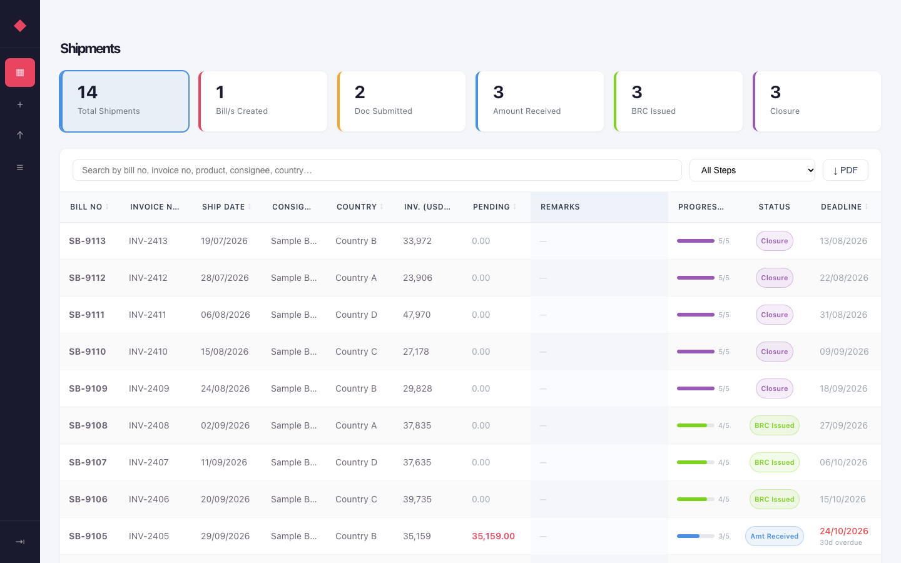
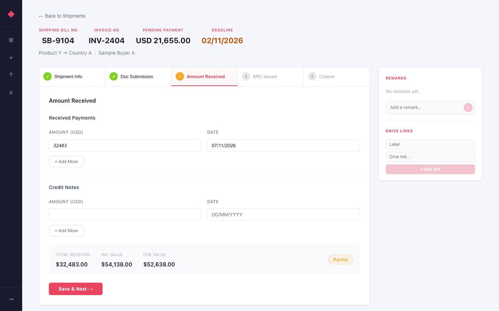
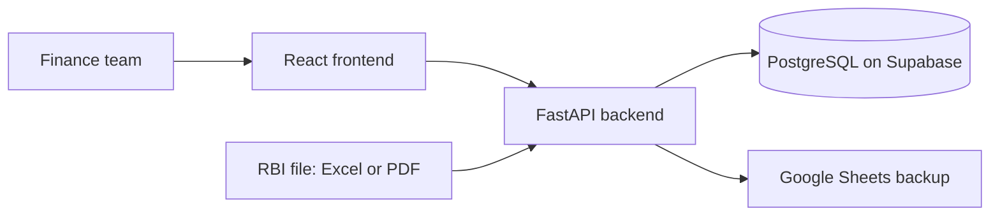

# MSTrace: Export Realization and RBI/BRC Tracking

A web tool that tracks each export shipment from shipping bill to RBI closure, built for the finance team of an agricultural export company in India.

> Source code is private because this is client/employer work. This repo documents the architecture and results.

*Screenshots use made-up sample data. Nothing shown is real.*

## Demo video

A 1 minute 44 second walkthrough with my voiceover, using sample data. Click the image to watch on YouTube (no sign-in needed).

## Overview

I built MSTrace for the finance team at the agricultural export company where I lead software engineering. They were tracking export shipments, payments, and BRC records in spreadsheets by hand, and it took days to cross-check everything. I wanted one place to follow each shipment from shipping bill to RBI closure.

I built a web app that moves each shipment through 5 steps: Shipping Bill, Doc Submitted, Amount Received, BRC Issued, and Closure. Closure has two parts: office closed and RBI completed.

What it does:

- **Dashboard:** a count for each step, search, filters, progress bars, deadlines, and PDF export.
- **RBI file check:** upload the RBI file as Excel or PDF, and the app lists which shipments are still open and which need to be marked closed.
- **Payment tracking:** received amounts and credit notes, partial or complete status, and the amount still pending.
- **Remarks and document links** on each shipment.
- **Roles and permissions:** admins and users, with permissions for actions like creating shipments or closing RBI records.
- **Google Sheets backup:** every save is copied to a Google Sheet, and admins can run a full backfill.

## How I built it

The React frontend talks to a FastAPI backend, which reads and writes to PostgreSQL on Supabase. The backend also writes each save to Google Sheets. A shipment only moves forward to the next step after a complete record for that step is saved.

## Tools

| Part | Tools |
| --- | --- |
| Frontend | React, Vite |
| Backend | FastAPI (Python) |
| Database and login | Supabase (PostgreSQL) |
| Backup | Google Sheets API |
| Hosting | Vercel (frontend), Render (backend) |

## Challenges and bugs fixed

The hardest part was making it reliable for people who use it every day. Users kept getting logged out because of small clock differences between devices. Supabase sometimes failed on short errors, so I added retries. The free server also went to sleep, so the first load was slow. I also had to fix the pending payment math, because partial payments gave wrong totals.

How I fixed each one:

- **Users getting logged out:** some users got "token expired" errors while their session was still valid. The browser and server clocks were slightly out of sync, so I added a small tolerance for clock differences.
- **Random failed requests:** short Supabase outages made profile lookups fail. I added caching and retries so one failed call doesn't break the page.
- **Slow first load:** the free Render server went to sleep when idle, so the first visit took a long time. I added a scheduled GitHub Action that keeps it awake.
- **Wrong pending amount:** partial payments gave wrong totals, so I fixed how the pending amount is calculated.
- **Date field in Chrome:** the custom date field didn't work right in Chrome, so I fixed it.

## What I learned

- Software has to keep working when things go wrong. Networks fail, servers sleep, and clocks drift, so I added retries and checks instead of assuming everything works.
- I learned to check my numbers with real cases, like partial payments, before I trust them.
