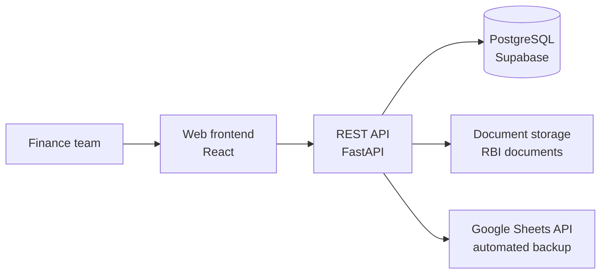

# MSTrace: GST Reconciliation

A 6-stage GST reconciliation tool built for the finance team of an agricultural export company in India.

> **Note:** Source code is private because this is client/employer work. This repo documents the architecture and results.

## The problem

The finance team reconciled GST in spreadsheets by hand, which took days of manual cross-checking.

## The solution

I replaced the spreadsheet process with a web tool that runs reconciliation in six stages. All RBI documents are centralized in one place, verifying a transaction takes one click, and data is backed up automatically to Google Sheets through the Google Sheets API.

## Key features

- **6-stage reconciliation workflow**
- **Centralized RBI documents** in one place
- **One-click verification** for each transaction
- **Automated Google Sheets backup** through the API
- **Audit-ready RBI submissions**

## Architecture

## Tech stack

| Layer | Technology |
| --- | --- |
| Frontend | React |
| Backend | FastAPI (Python) |
| Database | Supabase (PostgreSQL) |
| Backup | Google Sheets API |

## My role

Sole developer. I owned the workflow design, frontend, backend, database, and the Google Sheets backup.

## Outcomes

- Reconciliation time went from days of manual cross-checking to a single-session workflow.
- Per-transaction verification reduced to one click.
- All RBI documents centralized, supporting audit-ready RBI submissions.

## What I learned

Turning a manual spreadsheet process into fixed stages is what took reconciliation from days to a single session.
